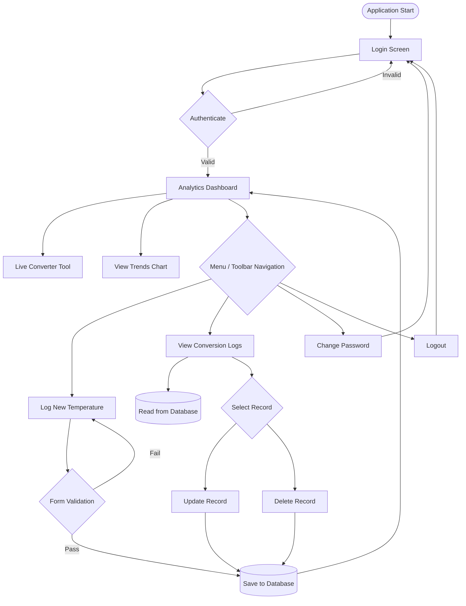

# Software Requirement Specification (SRS)
**Project Name:** Temperature Log & Analytics Manager
**Version:** 1.0 (Mid-Term 1 Deliverable)

## 1. Project Proposal
The "Temperature Log & Analytics Manager" is a desktop application designed to provide scientists, engineers, and general users with a robust, intuitive interface for converting temperatures across multiple scales (Celsius, Fahrenheit, Kelvin) and logging those conversions for historical tracking and analysis. The system is engineered using Java Swing for the frontend, incorporating a premium `FlatMacDarkLaf` UI theme for a modern aesthetic, and MySQL for secure, persistent data storage.

## 2. Scope
This application focuses on the core workflow of user authentication, real-time temperature conversion, data logging, and visual analytics. It is designed to run efficiently on standard desktop environments. The current scope covers a single-user or local multi-user environment where data is managed centrally via a MySQL database.

## 3. Functional Requirements
The system must support the following core modules:

- **Login System:** Secure access to the application using username and password authentication.
- **Menu/Toolbar:** Global navigation elements providing quick access to all major modules and actions (Dashboard, History, Settings).
- **Analytics Dashboard:** The central hub featuring:
  - A real-time, bidirectional temperature conversion tool.
  - A dynamic line chart (using `JFreeChart`) visualizing recent temperature trends and logged data.
- **Data Management (CRUD):**
  - **Add:** Form-based entry to log new temperature conversions (e.g., Sensor readings).
  - **View:** A styled data table presenting the historical logs.
  - **Update/Delete:** Capabilities to correct or remove erroneous entries from the database.
- **Form Validation:** Client-side validation ensuring inputs are numeric and required fields are not empty before processing.
- **Password Change:** Secure interface for the active user to update their credentials.
- **Logout:** Safely end the user session and return to the Login screen.

## 4. User Journey Flowchart

